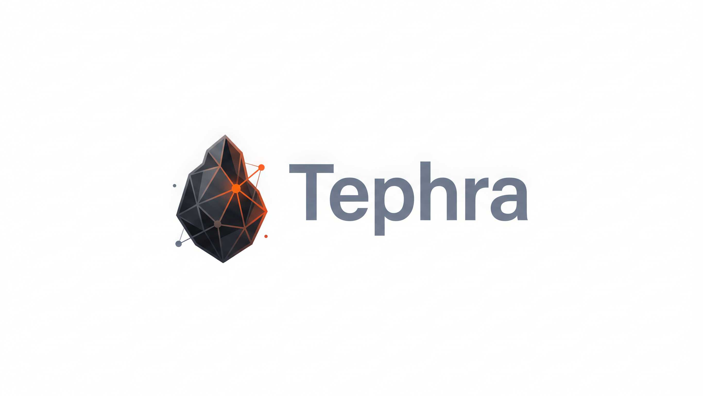

<p align="center"></p>

<p align="center">
  <em>A lightweight, Obsidian-compatible notes app for the desktop</em>
</p>

Tephra is a native notes app (Rust + GPUI) that opens your
existing Obsidian vaults in place and reads `.obsidian/`, keeping its own settings
in `.tephra/` inside the vault. It has a live-preview Markdown editor, typeset math (RaTeX, MathJax fallback), and the features Obsidian gets from plugins — search, graph,
backlinks, daily notes, templates, spellcheck, PDF export and more — built in as toggleable
plugins (see [docs/plugins.md](docs/plugins.md)). Appearance follows Obsidian themes and CSS
snippets (only their CSS variables apply), plus a bundled **Tephra** theme on top of the
default look (see [docs/themes.md](docs/themes.md)).

## Build

Requirements:

- Rust (pinned by `rust-toolchain.toml`, installed via rustup)
- Node.js + npm — only once, to build the embedded JS bundles (`make bundles`)

```sh
make build          # release build of `tephra` (+ winshot, the UI tests' screenshot tool)
target/release/tephra <vault-folder | note.md>
```

`make build` builds the JS bundles first if they are missing (they are gitignored). Plain
`cargo build --release -p tephra` works too once the bundles exist. `make help` lists all
targets.

## Test

```sh
make test           # unit + fixture tests (fixture tests skip when no fixture vault is present)
make test-all       # + PDF export of every fixture note + scripted UI tests (need a display)
```

Scripted UI tests drive the real binary with `TEPHRA_SCRIPT=<file>`; `TEPHRA_BENCH=1` runs the
typing benchmark.

## Packaging

One command per platform, output in `dist/` (see `packaging/README.md`):

| Command | Output |
|---|---|
| `make arch` | `dist/tephra-<ver>-<rel>-x86_64.pkg.tar.zst` (native makepkg) |
| `make deb` | `dist/tephra_<ver>-1_amd64.deb` (Debian 12 container) |
| `make windows` | `dist/tephra-<ver>-windows-x86_64.zip` (cross-compiled in a container; natively on Windows) |
| `make dist` | all three |

## Plugins

Every feature — including the "core" ones like search, backlinks and the outline — is a
bundled plugin built on one API (`crates/app/src/plugins/api.rs`). Plugins are toggled in
Settings → Plugins and apply without a restart; their settings live in
`<vault>/.tephra/plugins/<id>.json`. Loading third-party plugins is a planned direction, not
available yet — for now all plugins are first-party and in-process.

See [docs/plugins.md](docs/plugins.md) for the bundled plugin list and how the plugin system
works (registration points, settings, how to add a plugin).

## Themes

The default look follows Obsidian's own light/dark variables. One built-in theme ships with
the app as a secondary choice (Settings → Appearance): **Tephra**, a volcanic-ash palette —
one theme with two variants, dark and light, picked by the base color scheme setting
(system/light/dark).

Themes are per user, not per vault: any Obsidian theme installed in `<config dir>/themes/`
(`~/.config/tephra/themes`, `%APPDATA%\tephra\themes` on Windows) as `<name>/theme.css` (or
`<name>.css`) is offered in Settings → Appearance and applies to every vault. Only a theme's
CSS variables apply (colours, fonts, sizes); CSS snippets still come from the vault
(`.obsidian/snippets`), and only their variables apply there too.

See [docs/themes.md](docs/themes.md) for what a theme can set, where themes are loaded from,
and how to install or write one.

## Layout

```
crates/core    tephra-core — platform-agnostic core: document buffer, file I/O, Markdown parser
crates/app     tephra      — the GPUI app: editor, plugins, themes, vault UI
tools/winshot              — KWin screenshot tool used by the UI tests
tools/js-bundles           — builds the embedded MathJax/CM6 bundles (Node.js)
themes/                    — the bundled Tephra theme (dark & light variants in one file)
assets/                    — logo (SVG) and banner
docs/                      — plugin system and themes documentation
packaging/                 — Arch / Debian / Windows packages
tests/ui/                  — scripted UI tests
```

## Configuration

Per vault: `<vault>/.tephra/` (`app.json` app settings, `plugins.json` + `plugins/<id>.json`
plugin state, `hotkeys.json`, `workspace.json` layout). Per user:
`~/.config/tephra/` (`%APPDATA%\tephra` on Windows): the vault list (`vaults.json`) and
`themes/`. Environment: `TEPHRA_CONFIG_DIR`, `TEPHRA_DATA_DIR`, `TEPHRA_LOG`,
`TEPHRA_LOG_LEVEL`, `TEPHRA_SCRIPT`, `TEPHRA_BENCH`, `TEPHRA_TIMING`.

## Documentation

- [docs/plugins.md](docs/plugins.md) — the plugin system: API, bundled plugins, adding one
- [docs/themes.md](docs/themes.md) — themes and CSS snippets: what applies, where from, how to write one
- [packaging/README.md](packaging/README.md) — building the Arch / Debian / Windows packages
- [AGENTS.md](AGENTS.md) — contributor guide: mission, architecture, working on the repo, performance targets

## Contributing

See [AGENTS.md](AGENTS.md) for the project mission, the architecture, guidelines for working
on the repo, and the performance targets with the current measured numbers.

## Attributions

Tephra itself is MIT-licensed (see [LICENSE](LICENSE), © 2026 Alessandro Di Martino).

It stands on these works:

- **[GPUI](https://gpui.rs)** (via the `gpui-kit` crate, by Zed) — the UI framework.
- **[RaTeX](https://crates.io/crates/ratex-parser)** — a native Rust port of KaTeX used to
  typeset math; [MathJax](https://www.mathjax.org) (run in [QuickJS](https://bellard.org/quickjs/)
  via `rquickjs`) is the fallback for the few formulas RaTeX rejects. The headless
  [CodeMirror 6](https://codemirror.net) bundle (`@codemirror/state`, `@lezer/markdown`) is
  embedded for the editor's source-mode engine.
- **[Typst](https://typst.app)** (with `typst-pdf`, `resvg`) — PDF export, run in a separate
  worker process.
- **[spellbook](https://crates.io/crates/spellbook)** with Hunspell dictionaries — spellcheck.
- **[DejaVu fonts](https://dejavu-fonts.github.io)** (Bitstream Vera license) and
  **[IBM Plex Sans](https://github.com/IBM/plex)** (SIL Open Font License 1.1) — embedded into
  the binary so rendering is identical on every machine; their licenses are in
  `crates/app/assets/fonts/`.
- The full dependency list, with exact versions, is in `Cargo.lock`.

Obsidian is a trademark of Obsidian.md. Tephra is an independent project, not affiliated with
or endorsed by Obsidian; it reads Obsidian vaults and their `.obsidian/` settings but ships
none of Obsidian's code.

## License

MIT — see [LICENSE](LICENSE). The embedded UI fonts (DejaVu, IBM Plex Sans) carry their own
licenses in `crates/app/assets/fonts/`.
