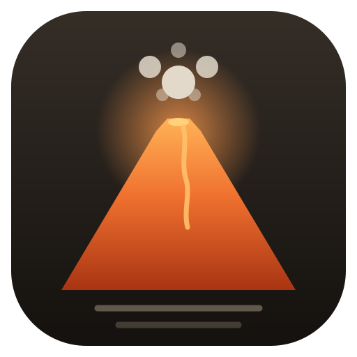

<!-- Banner spot: put a wide banner image here when you have one, e.g.
     <p align="center"></p> -->

<p align="center">
  
</p>

<h1 align="center">Tephra</h1>

<p align="center">
  <em>A lightweight, Obsidian-compatible notes app for the desktop — named for tephra,
  the volcanic ash that settles over everything, kin of the obsidian this app grew out of.</em>
</p>

Tephra is a native notes app (Rust + GPUI) that opens your
existing Obsidian vaults in place and reads `.obsidian/` as read-only, keeping its own settings
in `.tephra/` inside the vault. It has a live-preview Markdown editor, typeset math (MathJax), and the features Obsidian gets from plugins — search, graph,
backlinks, daily notes, templates, spellcheck, PDF export and more — built in as toggleable
plugins.

## Build

Requirements:

- Rust (pinned by `rust-toolchain.toml`, installed via rustup)
- Node.js + npm — only once, to build the embedded JS bundles (`make bundles`)

```sh
make build          # release build of `tephra` (+ winshot, the UI tests' screenshot tool)
target/release/tephra <vault-folder | note.md>
```

`make build` builds the JS bundles first if they are missing (they are gitignored). Plain
`cargo build --release -p tephra` works too once the bundles exist. `make help` lists all
targets.

## Test

```sh
make test           # unit + fixture tests
make test-all       # + PDF export of every fixture note + scripted UI tests (need a display)
```

Scripted UI tests drive the real binary with `TEPHRA_SCRIPT=<file>`; `TEPHRA_BENCH=1` runs the
typing benchmark.

## Packaging

One command per platform, output in `dist/` (see `packaging/README.md`):

| Command | Output |
|---|---|
| `make arch` | `dist/tephra-<ver>-<rel>-x86_64.pkg.tar.zst` (native makepkg) |
| `make deb` | `dist/tephra_<ver>-1_amd64.deb` (Debian 12 container) |
| `make windows` | `dist/tephra-<ver>-windows-x86_64.zip` (cross-compiled in a container) |
| `make dist` | all three |

## Themes

The default look follows Obsidian's own light/dark variables. One built-in theme ships with the
app as a secondary choice (Settings → Appearance): **Tephra**, a volcanic-ash palette (warm
basalt greys and ember accent in dark mode, warm paper and dark ember in light mode). It is a
single theme with two variants — the dark or light variant is picked by the base color scheme
setting (system/light/dark). Its source lives in `themes/Tephra/theme.css`; copy the folder into
`<vault>/.obsidian/themes/Tephra/` to install it into a vault (a vault theme of the same name
overrides the bundled one). Any Obsidian theme or CSS snippet from the vault works too — only
their CSS variables apply.

## Layout

```
crates/core    tephra-core — platform-agnostic core: document buffer, file I/O, Markdown parser
crates/app     tephra      — the GPUI app: editor, plugins, themes, vault UI
tools/winshot              — KWin screenshot tool used by the UI tests
tools/js-bundles           — builds the embedded MathJax/CM6 bundles (Node.js)
themes/                    — the built-in Tephra themes (dark & light variants)
assets/                    — logo (SVG + PNG) and future banner
packaging/                 — Arch / Debian / Windows packages
tests/ui/                  — scripted UI tests
```

## Configuration

Per vault: `<vault>/.tephra/` (app settings, plugin settings, workspace layout). Per user:
`~/.config/tephra/` (`%APPDATA%\tephra` on Windows). Environment: `TEPHRA_CONFIG_DIR`,
`TEPHRA_DATA_DIR`, `TEPHRA_LOG`, `TEPHRA_LOG_LEVEL`, `TEPHRA_SCRIPT`, `TEPHRA_BENCH`.

## License

MIT — see [LICENSE](LICENSE). The embedded UI fonts (DejaVu, IBM Plex Sans) carry their own
licenses in `crates/app/assets/fonts/`.
